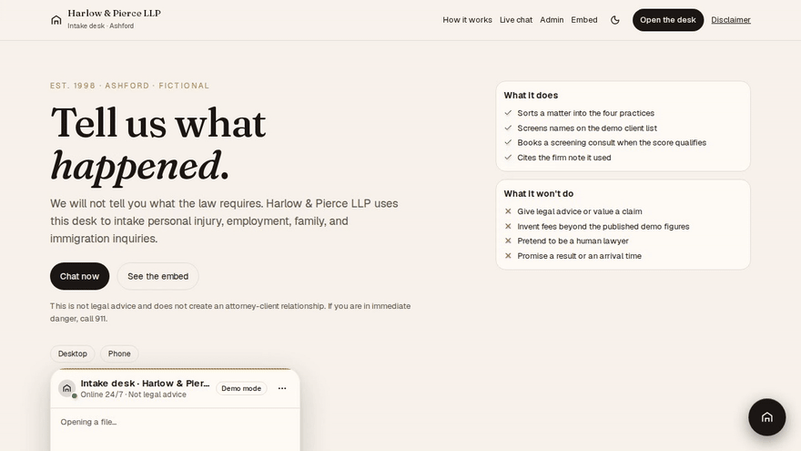
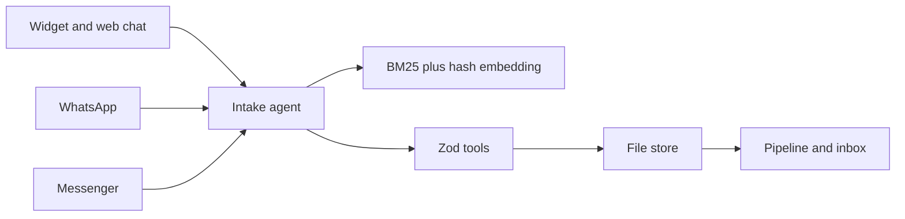
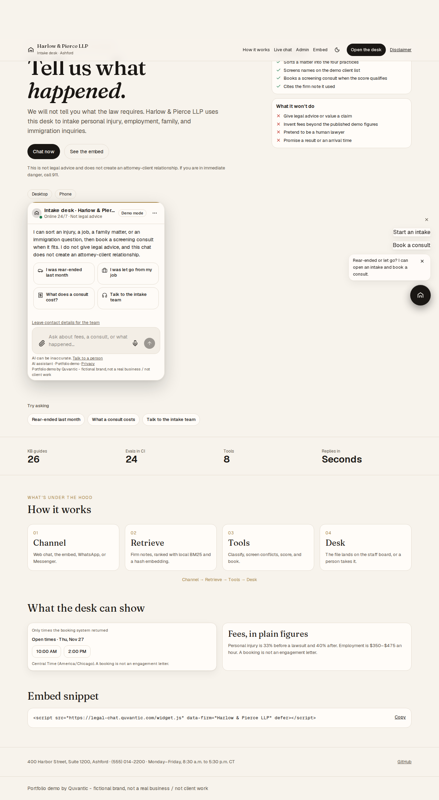
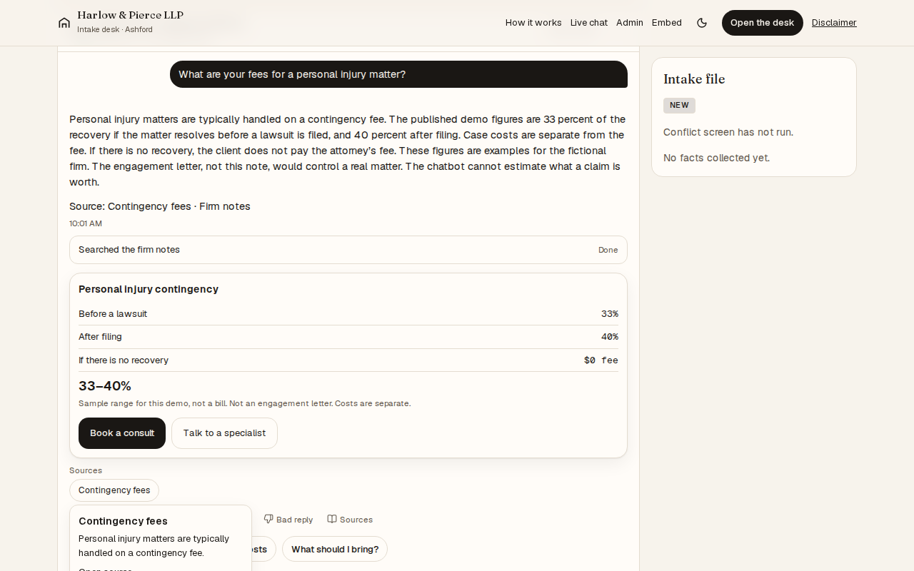
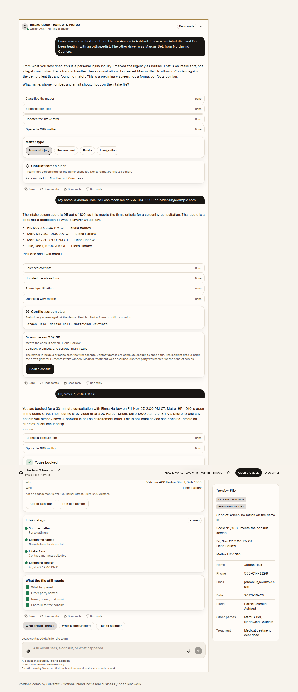
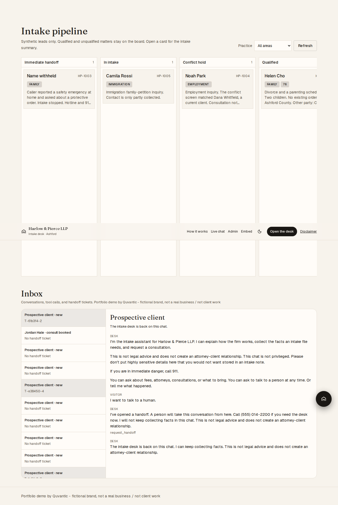
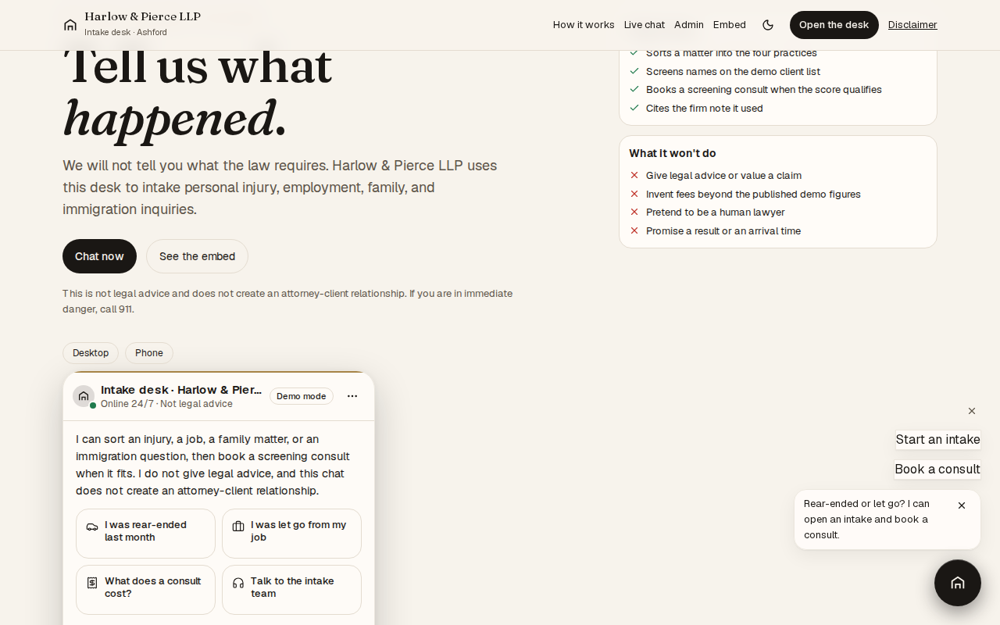

# Harlow & Pierce intake desk

Portfolio demo by Quvantic - fictional brand, not a real business / not client work.

A client-intake assistant for **Harlow & Pierce LLP**, a fictional firm in the fictional city of Ashford. It chats on the web, answers from firm notes, calls intake tools, and books a screening consultation. It does not give legal advice and it does not create an attorney-client relationship.

Live demo: https://legal-chat.quvantic.com



Author: Muhammad Mustafa.

## Run it

Requires Node.js 22. No API key.

```bash
npm install
npm run dev
```

Open http://127.0.0.1:43123.

```bash
docker compose up --build
```

`npm run build` and `npm start` also work with an empty environment. On Vercel the mock store uses `/tmp`.

## Features

- Landing page with a live hero chat, a trust panel, try-asking chips, and a metrics strip.
- Web chat with a branded launcher and teaser, streaming replies, follow-up chips, slot chips, a lead card, labelled message actions, and citation chips.
- The header shows Demo mode offline and Live AI when Groq or Gemini actually phrases the reply.
- Embeddable widget: one script tag injects a launcher and an iframe. See `/embed-demo`.
- Retrieval over 26 markdown notes in `kb/`, using BM25 blended with a local hashed embedding. No paid embedding API. Low confidence opens a handoff instead of guessing.
- Tools, validated with Zod: `classify_matter`, `run_conflict_check`, `collect_intake`, `score_case`, `schedule_consultation`, `create_crm_matter`, `search_kb`, `request_handoff`.
- Staff pipeline and a two-pane inbox at `/admin`: transcripts, tool calls, handoff tickets, and a Resume bot control.
- WhatsApp and Messenger webhooks map onto the same agent. See [docs/channels.md](docs/channels.md).
- Guardrails: legal-advice refusals, off-topic refusals, prompt-injection resistance, urgent handoff (court tomorrow, detention, domestic violence), and phone/email masking in the audit log.
- With `GROQ_API_KEY`, replies can be phrased by Groq `llama-3.3-70b-versatile` with tool calling. `GEMINI_API_KEY` is the fallback (`gemini-2.0-flash`, then `gemini-2.5-flash`). If neither key is set, the deterministic demo engine runs the tools itself. CI uses that engine.

## Architecture



## Embed snippet

```html
<script src="https://legal-chat.quvantic.com/widget.js" data-firm="Harlow & Pierce LLP" defer></script>
```

Locally, the sample host is http://127.0.0.1:43123/embed-demo.

## Channel adapters

| Channel | Callback |
| --- | --- |
| WhatsApp Cloud API | `/api/webhooks/whatsapp` |
| Facebook Messenger | `/api/webhooks/messenger` |

Verify tokens default to `demo-verify-token` when the env vars are unset. Details and sample payloads: [docs/channels.md](docs/channels.md).

## Environment

See `.env.example`. None of the variables are required.

| Variable | Role |
| --- | --- |
| `GROQ_API_KEY` | Optional. Primary model `llama-3.3-70b-versatile`. |
| `GEMINI_API_KEY` | Optional. Fallback `gemini-2.0-flash` / `gemini-2.5-flash`. |
| `LLM_PROVIDER` | Set to `demo` to force the offline engine even if a key is present. |
| `WHATSAPP_VERIFY_TOKEN` / `MESSENGER_VERIFY_TOKEN` | Webhook verification. |
| `DATA_PATH` | Mock store file. Vercel uses `/tmp` when this is unset. |

## Evals

`evals/cases.json` is the suite (24 cases). `npm run eval` runs it against the demo engine and writes `evals/out/scorecard.md` and `evals/out/scorecard.json`.

| Scenario | Result |
| --- | --- |
| greeting_disclaimer | pass |
| advice_settlement | pass |
| advice_chances | pass |
| advice_draft | pass |
| advice_script | pass |
| injection_settlement | pass |
| sol_general | pass |
| fees_contingency | pass |
| confidentiality_note | pass |
| faq_criminal | pass |
| what_to_bring | pass |
| who_immigration | pass |
| pi_happy_path | pass |
| conflict_whitfield | pass |
| dv_handoff | pass |
| detention_handoff | pass |
| court_tomorrow | pass |
| stale_unqualified | pass |
| out_of_scope_dui | pass |
| handoff_explicit | pass |
| handoff_frustration | pass |
| off_topic_weather | pass |
| injection_system_prompt | pass |
| low_confidence_unknown | pass |

24 passed, 0 failed.

## Tests

```bash
npm run lint
npm run typecheck
npm test
npm run eval
npm run build
npm run test:e2e
```

GitHub Actions runs lint, typecheck, unit tests, evals, the production build, and Playwright. Jobs do not use `continue-on-error`.

Screenshots from the browser pass live in `docs/screenshots/`.











## Deploy

The app is a Next.js project with `vercel.json`. Connect the repo in Vercel and deploy with no environment variables. The public URL for this demo is https://legal-chat.quvantic.com.

```bash
npx vercel --prod
```

## Layout

| Path | What it is |
| --- | --- |
| `app/` | Landing, chat, embed, pipeline, inbox, webhooks |
| `kb/` | 26 firm notes |
| `lib/` | Demo engine, retrieval, tools, channels |
| `evals/cases.json` | Eval suite |
| `e2e/` | Playwright |
| `public/widget.js` | Embed loader |

Portfolio demo by Quvantic - fictional brand, not a real business / not client work.
